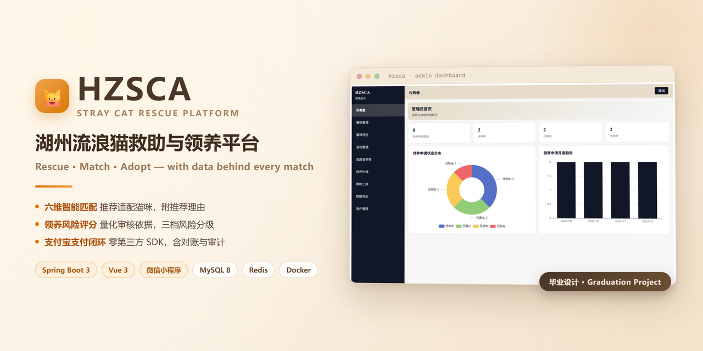
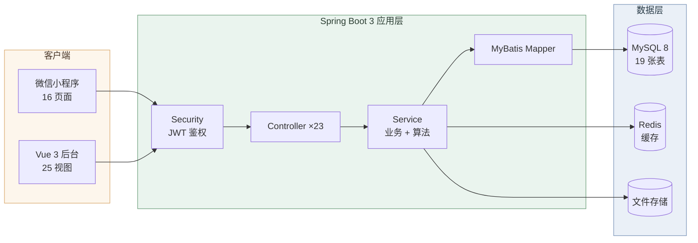

<div align="center">



<br>
<br>

[](https://spring.io/projects/spring-boot)
[](https://vuejs.org/)
[](https://vitejs.dev/)
[](#)
[](https://www.mysql.com/)
[](https://redis.io/)
[](#-测试与质量)
[](LICENSE)

**简体中文** · [English](README_EN.md)

</div>

---

## 🔧 工程亮点

- **零第三方 SDK 的支付实现** —— 支付宝 RSA2 签名与验签全部基于 JDK `java.security` 手写，可离线构建，也便于讲解原理
- **数据库启动自举** —— 新环境只需建一个空库；表结构、种子数据、管理员账号由 `DbBootstrap` 幂等创建，且**绝不 `DROP`**
- **真·对账兜底** —— 不假设异步通知一定送达：主动查单补记 + 超时关单 + 审计一致性检查，每日定时执行
- **可验证的算法** —— 两个核心算法配 41 个单元测试，覆盖档位边界与全部硬性排除规则
- **工程化收口** —— Docker 多阶段构建 + Compose profile 一键起全栈；前端分包后入口 chunk 1,141 KB → 25 KB

---

## 📖 项目简介

**HZSCA（Huzhou Stray Cat Association）** 是面向流浪猫救助公益组织的综合管理平台，也是本人的本科毕业设计作品。围绕救助业务的真实链路，平台解决三件事：

| 角色 | 解决的问题 |
|------|-----------|
| 🙋 **救助侧** | 志愿者与热心市民上报流浪猫线索（定位 / 紧急度 / 图片），管理员统一调度跟进 |
| 🏠 **领养侧** | 用户填写偏好问卷后，系统推荐适配猫咪并生成领养风险评分，辅助审核决策 |
| 🛠️ **运营侧** | 猫咪档案、特征标签、活动、志愿者审核、领养审核、救助工单、数据导出 |

---

## 🖼️ 界面预览

### 用户端 · 微信小程序

<div align="center">

| 首页 | 领养列表 | 猫咪详情 |
| :---: | :---: | :---: |
|  |  |  |

| 活动列表 | 爱心捐助 | 支付成功 |
| :---: | :---: | :---: |
|  |  |  |

</div>

### 管理端 · Vue 运营后台

<div align="center">

| 数据仪表盘 | 猫咪档案管理 | 猫咪特征标签 |
| :---: | :---: | :---: |
|  |  |  |

| 领养申请审核 | 志愿者审核 | 救助上报处理 |
| :---: | :---: | :---: |
|  |  |  |

</div>

---

## 🎯 核心功能

| 模块 | 能力 |
|------|------|
| **智能匹配** | 偏好档案 → 硬性排除 + 六维加权打分 → Top-N 推荐，并给出「优势 / 需磨合」理由 |
| **风险评分** | 领养问卷 → 100 分制加减分 → `LOW / MEDIUM / HIGH` 三档，保留明细作为审核依据 |
| **爱心捐助** | 金额选择 → 支付宝沙箱收银台 → 结果轮询 → 对账审计；未配置密钥时自动降级为 Mock 演示 |
| 猫咪与活动 | 档案浏览、猫咪详情、活动报名、救助线索上报（含定位与图片） |
| 用户体系 | 微信静默登录 + 网页注册登录，`user` / `volunteer` / `admin` 三级角色 |
| 运营后台 | 数据仪表盘（ECharts）、九大管理模块、数据导出、审核工单 |
| 公共能力 | JWT 无状态鉴权、BCrypt 口令、统一响应体、Swagger 文档、Redis 缓存、上传白名单 |

---

## 🏗️ 系统架构



---

## 🛠️ 技术栈

| 层 | 技术 |
|---|---|
| **后端** | Spring Boot 3.3.12 · Java 17 · Spring Security 6 · MyBatis 3.0.4 · JJWT 0.12.6 · SpringDoc 2.3.0 |
| **前端** | Vue 3.4 · Vite 5.1 · Element Plus 2.5.6 · ECharts 5.5 · Vue Router 4 · wangEditor 5 |
| **小程序** | 微信原生框架（16 个页面 + 自定义 tabBar） |
| **数据** | MySQL 8（19 张表） · Redis 7 |
| **支付** | 支付宝沙箱 · RSA2 签名（JDK 内置实现，零第三方 SDK） |
| **部署** | Docker 多阶段构建 · Docker Compose（`--profile full` 全栈一键启动） |

---

## 🚀 快速开始

**环境要求**：JDK 17+ · MySQL 8+ · Redis 6+ · Node.js 18+ ·（可选）Docker · 微信开发者工具

### 1️⃣ 启动依赖服务

```bash
# 方式 A：Docker Compose（推荐）
docker compose up -d                            # 仅启动 MySQL + Redis
docker compose --profile full up -d --build     # 全栈一键启动（额外构建后端容器）

# 方式 B：手动安装 —— 见 docs/部署指南.md（含 Windows / macOS / Linux）
```

### 2️⃣ 初始化数据库

```bash
mysql -uroot -p -e "CREATE DATABASE IF NOT EXISTS hzsca DEFAULT CHARACTER SET utf8mb4;"
```

> 只需创建**空库**。表结构、演示数据、管理员账号与支付表均由 `DbBootstrap` 在启动时**自动创建**，幂等且不会删改已有数据。

### 3️⃣ 启动后端

```bash
cd hzsca-springboot/hzsca

export JWT_SECRET="不少于32字节的随机字符串"      # 必填
export DB_USERNAME=root
export DB_PASSWORD=你的数据库密码

./mvnw spring-boot:run
# Windows 用户可直接运行：../../start-backend.bat
```

启动后：接口地址 `http://localhost:8080` ｜ 接口文档 `http://localhost:8080/swagger-ui.html`

### 4️⃣ 启动管理后台

```bash
cd hzsca-vue/hzsca
npm install
npm run dev        # http://localhost:5173
```

> 若后端地址非 `localhost:8080`，修改 `src/config/config.js` 的 `baseURL` 与 `imageBaseURL`。

### 5️⃣ 运行微信小程序

用微信开发者工具导入 `hzsca-miniapp` → 修改 `utils/config.js` 的 `BASE_URL` → 本地调试勾选「不校验合法域名」。

### 🔑 演示账号

| 角色 | 账号 | 口令 |
|------|------|------|
| 管理员 | `admin` | `admin123456` |
| 网页用户 | `user1` ~ `user10` | `123456` |

---

## 🧠 核心算法

> 完整设计与局限分析见 [`docs/算法说明与局限分析.md`](docs/算法说明与局限分析.md)

**① 猫咪智能匹配** · `MatchServiceImpl`

```
用户偏好档案
  ├─ 阶段一 · 硬性排除：过敏×掉毛 / 儿童×不亲童 / 他宠×不亲宠 / 特殊照护 / 空间不足
  └─ 阶段二 · 六维加权：活动量 1.0 · 亲人度 0.6 · 掉毛 1.2 · 空间 1.0 · 新手友好 1.0 · 作息 1.0
                score = Σ(权重ᵢ × 匹配度ᵢ) / Σ权重ᵢ × 100  →  Top-N 推荐 + 推荐理由
```

**② 领养风险评分** · `RiskScoringServiceImpl`

```
过敏 −25 ｜ 哮喘 −15 ｜ 吸烟 −10 ｜ 工时≥12h −12 ｜ 收入<3000 −10 ｜ 无养宠经验 −5 ｜ 拒绝回访 −8

        →   ≥80 LOW    ｜    60~79 MEDIUM    ｜    <60 HIGH
```

评分明细逐项入库，作为管理员审核时的量化依据。

---

## 📁 项目结构

```
HZSCA-WEB/
├── hzsca-springboot/hzsca/      # 🔧 后端服务（Spring Boot）
│   ├── src/main/java/com/hzsca/ #   common / config / controller / entity / mapper / security / service / utils
│   ├── src/main/resources/      #   db 建表脚本 · mapper XML · static 图片 · application.yml
│   ├── src/test/                #   ✅ 41 个单元测试
│   └── Dockerfile               #   🐳 多阶段构建
├── hzsca-vue/hzsca/             # 🖥️ 管理后台（Vue 3 + Vite）
├── hzsca-miniapp/               # 📱 微信小程序（原生）
├── docs/                        # 📚 部署指南 · 支付接入指南 · 算法局限分析 · 截图
├── deliverables/gstack/         # 📋 归档评审报告
├── docker-compose.yml           # 🐳 MySQL + Redis（--profile full 含后端）
└── .env.example                 # 🔑 环境变量示例
```

---

## ✅ 测试与质量

```bash
cd hzsca-springboot/hzsca
./mvnw -o test -Dtest='RiskScoringServiceImplTest,MatchServiceImplTest'
# Tests run: 41, Failures: 0, Errors: 0, Skipped: 0
```

41 个单元测试覆盖两个核心算法的单项加减分、档位边界（80 / 79 / 60 / 59）、上下界截断、硬性排除规则、`limit` 边界与排序。

| 构建指标 | 结果 |
|---------|------|
| 后端编译 | ✅ 通过 |
| 前端构建 | ✅ 通过，无 >500KB chunk 警告 |
| 入口 chunk | 1,141 KB → **25 KB**（`manualChunks` + 按需引入） |
| 静态图片 | 161 MB → **6.2 MB**（WebP） |

---

## 📚 文档导航

| 文档 | 内容 |
|------|------|
| [毕业设计论文.md](毕业设计论文.md) | 论文全文 |
| [docs/部署指南.md](docs/部署指南.md) | 环境搭建 · Docker 全栈部署 · 首次运行检查清单 |
| [docs/支付接入指南.md](docs/支付接入指南.md) | 支付宝沙箱申请 · 密钥生成 · 回调调试 · 对账与审计 |
| [docs/算法说明与局限分析.md](docs/算法说明与局限分析.md) | 算法设计 · 已知局限 · 改进方向（论文素材） |
| [deliverables/gstack/](deliverables/gstack/) | 归档评审报告（架构梳理 + 缺陷审计 + 修复验证） |
| [schema.sql](hzsca-springboot/hzsca/src/main/resources/db/schema.sql) | 完整数据表结构 |
| Swagger UI | 完整接口清单（启动后访问 `http://localhost:8080/swagger-ui.html`） |

---

## 🗺️ Roadmap

- [x] 两个核心算法的单元测试（41 例）
- [x] 明文口令 BCrypt 一次性迁移
- [x] Docker 全栈部署方案
- [x] 图片转 WebP（体积 −96%）
- [x] 支付宝沙箱支付 + 对账与审计日志
- [x] 前端分包与按需加载
- [x] 小程序端支付流程
- [ ] 小程序接入微信支付（复用 `PaymentService` 接口）
- [ ] 算法离线评估指标（AUC / NDCG）
- [ ] 图片迁移对象存储 · Element Plus 样式按需引入

---

## 🤝 贡献指南

欢迎提交 Issue 与 Pull Request。

**1. 分支约定** —— 从 `main` 切出功能分支，命名 `feat/xxx`、`fix/xxx`、`docs/xxx`

**2. 代码规范**

- **后端**：Java 17；遵循现有分包（`controller / service / mapper / entity`）；新增接口须在 `SecurityConfig` 中明确权限，禁止默认放行
- **前端**：Vue 3 组合式 API + `<script setup>`；样式沿用现有暖色调变量
- **数据库**：建表脚本使用 `CREATE TABLE IF NOT EXISTS`，禁止 `DROP`

**3. 提交前自检**

```bash
cd hzsca-springboot/hzsca && ./mvnw -o test -Dtest='RiskScoringServiceImplTest,MatchServiceImplTest'
cd hzsca-vue/hzsca && npm run build
```

**4. 提交信息** —— 遵循 [Conventional Commits](https://www.conventionalcommits.org/)：`feat:` / `fix:` / `docs:` / `chore:`

**5. PR 描述** —— 说明改动动机、影响范围与验证方式

> 🔐 **安全提示**：请勿提交任何真实密钥（`JWT_SECRET`、支付宝私钥、微信 AppSecret）。本地配置使用 `.env`（已被 `.gitignore` 忽略），可参考 `.env.example`。

---

## 📄 许可证

[Apache License 2.0](LICENSE) · 本项目为本科毕业设计作品，仅供学习与交流。

---

<div align="center">

**如果这个项目对你有帮助，欢迎点一个 ⭐ Star**

愿每一只流浪猫，都能被温柔以待。🐾

</div>
