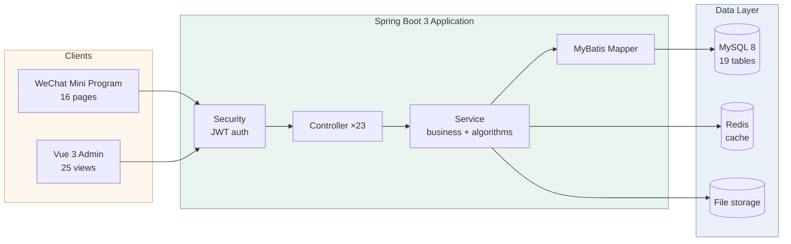

<div align="center">

# 🐱 HZSCA

### Stray Cat Rescue & Adoption Platform

**Connecting rescuers, adopters, and stray cats — with data behind every match.**

One backend · Two frontends — a WeChat Mini Program for end users, a Vue admin console for operations

[](https://spring.io/projects/spring-boot)
[](https://vuejs.org/)
[](https://vitejs.dev/)
[](#)
[](https://www.mysql.com/)
[](https://redis.io/)
[](#-testing--quality)
[](LICENSE)

[简体中文](README.md) · **English**

</div>

---

## ✨ Why It Stands Out

- 🧠 **Algorithm-driven decisions** — far beyond plain CRUD: a **six-dimension weighted matching model** answers "which cat suits this adopter", and a **risk-scoring model** supports adoption review
- 💰 **Complete payment loop** — order → cashier → signed async notification → active query fallback → daily reconciliation & audit, all with **zero third-party SDKs** (RSA2 implemented on the JDK)
- 🚀 **Production-minded engineering** — one-command Docker stack · self-bootstrapping database · 41 unit tests · a 25 KB entry bundle
- 🎓 **Archive-grade docs** — full thesis, deployment guide, payment integration guide, and algorithm limitation analysis

---

## 📖 Overview

**HZSCA (Huzhou Stray Cat Association)** is a management platform for stray-cat rescue organizations, and my undergraduate graduation project. Built around the real rescue workflow, it addresses three concerns:

| Role | What it solves |
|------|----------------|
| 🙋 **Rescue** | Volunteers and citizens report stray-cat sightings (location / urgency / photos); admins dispatch and follow up |
| 🏠 **Adoption** | Users fill in a preference profile; the system recommends suitable cats and produces a risk score to assist review |
| 🛠️ **Operations** | Cat records, trait tags, events, volunteer review, adoption review, rescue tickets, and data export |

---

## 🖼️ Screenshots

### End Users · WeChat Mini Program

<div align="center">

| Home | Adoptable Cats | Cat Detail |
| :---: | :---: | :---: |
|  |  |  |

| Events | Donate | Payment Success |
| :---: | :---: | :---: |
|  |  |  |

</div>

### Administrators · Vue Admin Console

<div align="center">

| Dashboard | Cat Records | Cat Traits |
| :---: | :---: | :---: |
|  |  |  |

| Adoption Review | Volunteer Review | Rescue Reports |
| :---: | :---: | :---: |
|  |  |  |

</div>

---

## 🎯 Features

| Module | Capability |
|--------|-----------|
| **Smart Matching** | Preference profile → hard exclusion + six-dimension weighted scoring → Top-N recommendations with "strengths / watch-outs" reasons |
| **Risk Scoring** | Adoption questionnaire → 100-point additive scoring → `LOW / MEDIUM / HIGH` tiers, with per-item breakdown for reviewers |
| **Donations** | Amount selection → Alipay sandbox cashier → result polling → reconciliation & audit; auto-degrades to a mock flow when keys are absent |
| Cats & Events | Browsing, cat detail, event sign-up, rescue reporting (with geolocation and photos) |
| Accounts | Silent WeChat login + web sign-up/sign-in, with `user` / `volunteer` / `admin` roles |
| Admin Console | ECharts dashboard, nine management modules, data export, review tickets |
| Shared | Stateless JWT auth, BCrypt passwords, unified response envelope, Swagger docs, Redis cache, upload whitelist |

---

## 🏗️ Architecture



---

## 🛠️ Tech Stack

| Layer | Technologies |
|---|---|
| **Backend** | Spring Boot 3.3.12 · Java 17 · Spring Security 6 · MyBatis 3.0.4 · JJWT 0.12.6 · SpringDoc 2.3.0 |
| **Frontend** | Vue 3.4 · Vite 5.1 · Element Plus 2.5.6 · ECharts 5.5 · Vue Router 4 · wangEditor 5 |
| **Mini Program** | Native WeChat framework (16 pages + custom tab bar) |
| **Data** | MySQL 8 (19 tables) · Redis 7 |
| **Payments** | Alipay sandbox · RSA2 signing (JDK built-in, no third-party SDK) |
| **Deployment** | Multi-stage Dockerfile · Docker Compose (`--profile full` for the whole stack) |

---

## 🚀 Quick Start

**Prerequisites**: JDK 17+ · MySQL 8+ · Redis 6+ · Node.js 18+ · (optional) Docker · WeChat DevTools

### 1️⃣ Start dependencies

```bash
# Option A: Docker Compose (recommended)
docker compose up -d                            # MySQL + Redis only
docker compose --profile full up -d --build     # Full stack (also builds the backend container)

# Option B: Manual install — see docs/部署指南.md (Windows / macOS / Linux)
```

### 2️⃣ Create the database

```bash
mysql -uroot -p -e "CREATE DATABASE IF NOT EXISTS hzsca DEFAULT CHARACTER SET utf8mb4;"
```

> An **empty database is enough**. Tables, demo data, the admin account, and payment tables are all created automatically on startup by `DbBootstrap` — idempotent, and it never drops or overwrites existing data.

### 3️⃣ Start the backend

```bash
cd hzsca-springboot/hzsca

export JWT_SECRET="a-random-string-of-at-least-32-bytes"   # required
export DB_USERNAME=root
export DB_PASSWORD=your-db-password

./mvnw spring-boot:run
# On Windows you can simply run: ../../start-backend.bat
```

Then: API at `http://localhost:8080` · API docs at `http://localhost:8080/swagger-ui.html`

### 4️⃣ Start the admin console

```bash
cd hzsca-vue/hzsca
npm install
npm run dev        # http://localhost:5173
```

> If your backend is not on `localhost:8080`, update `baseURL` and `imageBaseURL` in `src/config/config.js`.

### 5️⃣ Run the Mini Program

Import `hzsca-miniapp` into WeChat DevTools → set `BASE_URL` in `utils/config.js` → enable "Skip domain validation" for local debugging.

### 🔑 Demo Accounts

| Role | Username | Password |
|------|----------|----------|
| Administrator | `admin` | `admin123456` |
| Web user | `user1` ~ `user10` | `123456` |

---

## 🧠 Core Algorithms

> Full design and limitation analysis: [`docs/算法说明与局限分析.md`](docs/算法说明与局限分析.md)

**① Cat Matching** · `MatchServiceImpl`

```
User preference profile
  ├─ Stage 1 · Hard exclusion: allergy×shedding / kids×not child-friendly /
  │            other pets×not pet-friendly / special care / insufficient space
  └─ Stage 2 · Six-dimension weighting:
               activity 1.0 · affection 0.6 · shedding 1.2 · space 1.0 · beginner 1.0 · schedule 1.0
               score = Σ(weightᵢ × fitnessᵢ) / Σweightᵢ × 100  →  Top-N with reasons
```

**② Adoption Risk Scoring** · `RiskScoringServiceImpl`

```
Allergy −25 ｜ Asthma −15 ｜ Smoking −10 ｜ Work ≥12h −12 ｜ Income <3000 −10 ｜ No pet experience −5 ｜ Refuses follow-up −8

        →   ≥80 LOW    ｜    60~79 MEDIUM    ｜    <60 HIGH
```

Every score component is persisted as quantitative evidence for reviewers.

---

## 📁 Project Structure

```
HZSCA-WEB/
├── hzsca-springboot/hzsca/      # 🔧 Backend (Spring Boot)
│   ├── src/main/java/com/hzsca/ #   common / config / controller / entity / mapper / security / service / utils
│   ├── src/main/resources/      #   db scripts · mapper XML · static images · application.yml
│   ├── src/test/                #   ✅ 41 unit tests
│   └── Dockerfile               #   🐳 Multi-stage build
├── hzsca-vue/hzsca/             # 🖥️ Admin console (Vue 3 + Vite)
├── hzsca-miniapp/               # 📱 WeChat Mini Program (native)
├── docs/                        # 📚 Deployment · payment integration · algorithm analysis · screenshots
├── deliverables/gstack/         # 📋 Archive review reports
├── docker-compose.yml           # 🐳 MySQL + Redis (backend included under --profile full)
└── .env.example                 # 🔑 Environment variable template
```

---

## ✅ Testing & Quality

```bash
cd hzsca-springboot/hzsca
./mvnw -o test -Dtest='RiskScoringServiceImplTest,MatchServiceImplTest'
# Tests run: 41, Failures: 0, Errors: 0, Skipped: 0
```

41 unit tests cover per-item scoring, tier boundaries (80 / 79 / 60 / 59), clamping, all hard-exclusion rules, `limit` boundaries, and result ordering.

| Build Metric | Result |
|--------------|--------|
| Backend compile | ✅ Passing |
| Frontend build | ✅ Passing, no >500 KB chunk warnings |
| Entry chunk | 1,141 KB → **25 KB** (`manualChunks` + on-demand imports) |
| Static images | 161 MB → **6.2 MB** (WebP) |

---

## 📚 Documentation

| Document | Contents |
|----------|----------|
| [毕业设计论文.md](毕业设计论文.md) | Full graduation thesis (Chinese) |
| [docs/部署指南.md](docs/部署指南.md) | Environment setup · Docker stack · first-run checklist (Chinese) |
| [docs/支付接入指南.md](docs/支付接入指南.md) | Alipay sandbox onboarding · key generation · callback debugging · reconciliation (Chinese) |
| [docs/算法说明与局限分析.md](docs/算法说明与局限分析.md) | Algorithm design · known limitations · improvement directions (Chinese) |
| [deliverables/gstack/](deliverables/gstack/) | Archive review reports (architecture, defect audit, fix verification) |
| [schema.sql](hzsca-springboot/hzsca/src/main/resources/db/schema.sql) | Complete database schema |
| Swagger UI | Full API reference (visit `http://localhost:8080/swagger-ui.html` after startup) |

---

## 🗺️ Roadmap

- [x] Unit tests for both core algorithms (41 cases)
- [x] One-off migration of plaintext passwords to BCrypt
- [x] Docker full-stack deployment
- [x] Images converted to WebP (−96% in size)
- [x] Alipay sandbox payments + reconciliation & audit log
- [x] Frontend chunk splitting and on-demand imports
- [x] Payment flow in the Mini Program
- [ ] WeChat Pay integration for the Mini Program (reusing the `PaymentService` interface)
- [ ] Offline evaluation metrics for the algorithms (AUC / NDCG)
- [ ] Object storage for images · on-demand Element Plus styles

---

## 🤝 Contributing

Issues and pull requests are welcome.

**1. Branching** — branch off `main` and name it `feat/xxx`, `fix/xxx`, or `docs/xxx`

**2. Code conventions**

- **Backend**: Java 17; follow the existing layering (`controller / service / mapper / entity`); every new endpoint must declare explicit permissions in `SecurityConfig` — never leave it open by default
- **Frontend**: Vue 3 Composition API with `<script setup>`; reuse the existing warm-tone style variables
- **Database**: use `CREATE TABLE IF NOT EXISTS`; never `DROP`

**3. Verify before committing**

```bash
cd hzsca-springboot/hzsca && ./mvnw -o test -Dtest='RiskScoringServiceImplTest,MatchServiceImplTest'
cd hzsca-vue/hzsca && npm run build
```

**4. Commit messages** — follow [Conventional Commits](https://www.conventionalcommits.org/): `feat:` / `fix:` / `docs:` / `chore:`

**5. Pull requests** — describe the motivation, scope of change, and how you verified it

> 🔐 **Security notice**: never commit real secrets (`JWT_SECRET`, Alipay private keys, WeChat AppSecret). Keep local configuration in `.env`, which is already git-ignored — see `.env.example`.

---

## 📄 License

[Apache License 2.0](LICENSE) · This is an undergraduate graduation project, intended for learning and exchange.

---

<div align="center">

**If you find this project useful, a ⭐ Star would be much appreciated**

May every stray cat be treated with tenderness. 🐾

</div>
