# 基于 Spring Boot + Vue + 微信小程序的流浪猫救助与领养系统的设计与实现（本科毕业设计论文）

## 封面信息（可替换）

- 题目：**基于 Spring Boot + Vue + 微信小程序的流浪猫救助与领养系统的设计与实现**
- 学校/学院：【可替换】
- 专业：【可替换】
- 学生姓名/学号：【可替换】
- 指导教师：【可替换】
- 完成日期：【可替换】

---

## 工程结构概览（树状）

```
HZSCA-WEB - 副本/
├─ hzsca-springboot/                 # 后端（Spring Boot）
│  └─ hzsca/
│     ├─ src/main/java/com/hzsca/
│     │  ├─ common/                  # 通用返回、跨域等
│     │  ├─ config/                  # 配置、DB初始化、静态映射
│     │  ├─ controller/              # REST接口
│     │  ├─ entity/                  # 实体/DTO
│     │  ├─ mapper/                  # MyBatis Mapper接口
│     │  ├─ security/                # JWT与Spring Security
│     │  └─ service/                 # 业务服务
│     ├─ src/main/resources/
│     │  ├─ db/                      # 建表/增量脚本/演示数据
│     │  ├─ mapper/                  # MyBatis XML
│     │  └─ static/                  # 静态图片资源（cats/activity）
│     └─ src/main/resources/application.yml
├─ hzsca-vue/                        # 网页端（Vue3 + Vite）
│  └─ hzsca/
│     ├─ src/router/                 # 前端路由与守卫
│     ├─ src/views/                  # 页面（用户端/管理端）
│     ├─ src/utils/                  # Axios封装
│     ├─ src/config/                 # baseURL/图片基址
│     ├─ package.json / vite.config.js
├─ hzsca-miniapp/                    # 微信小程序端
│  ├─ app.json/app.js/app.wxss       # 小程序全局配置
│  ├─ custom-tab-bar/                # 自定义tabBar
│  ├─ pages/                         # 页面（首页/领养/活动/我的等）
│  └─ utils/                         # request/auth封装
└─ Redis/                            # 本地Redis可执行文件（运行环境辅助）
```

---

## 角色与业务概览

### 角色划分与数据来源

- 管理员（admin）：后台管理猫咪、活动、领养/救助审核、志愿者审核、活动报名审核、数据统计可视化。
- 普通用户（user）：
  - 网页端用户：来自 `users` 表（账号密码登录）。
  - 小程序用户：来自 `wx_user` 表（微信登录，openid 绑定）。
- 志愿者（volunteer）：由普通用户提交申请，经管理员审核后授予角色；可报名参加活动。

### 核心业务流（系统主线）

- 猫咪信息：展示/详情/管理（管理员可增删改；用户查看）。
- 领养申请：用户提交申请→系统风险评分→管理员审核→状态流转（猫咪状态锁定/释放）。
- 救助上报：用户提交位置与描述→管理员指派与处理→状态流转。
- 活动：管理员发布/维护活动（含图片）→用户浏览→志愿者报名参加→管理员审核报名→查看参与名单。
- 志愿者：用户申请→管理员审核→授予志愿者身份→参与活动报名。
- 数据可视化：管理员首页展示领养申请统计（总量、状态分布、趋势图）。

---

# 摘要（中文）

本课题面向校园与城市社区的流浪猫救助与领养管理场景，设计并实现了一套“网页端 + 微信小程序端 + 管理后台”的多端协同系统。系统以 Spring Boot 为后端核心，采用 MyBatis 进行数据持久化，结合 JWT 与 Spring Security 完成统一认证与角色授权；网页端基于 Vue3、Element Plus 实现用户端与管理端的交互界面，小程序端以微信小程序原生框架实现移动场景下的救助上报、活动参与与个人中心等功能。系统围绕猫咪信息、领养申请、救助上报、志愿者审核与活动报名审核等关键业务构建标准化的状态流转机制，并通过演示数据播种与管理端可视化图表提高展示与验收效率。实践表明，该系统能满足多角色、多终端的业务需求，具有较好的可维护性与扩展性，为校园公益类信息化管理提供了可行的实现方案。

**关键词**：流浪猫救助；领养系统；Spring Boot；Vue；微信小程序；JWT；角色权限

---

# Abstract (English)

This project designs and implements a multi-client stray-cat rescue and adoption management system for campus and community scenarios. The backend is built with Spring Boot and MyBatis for persistence, while JWT and Spring Security provide unified authentication and role-based authorization. The web client is developed using Vue 3 and Element Plus for both user-facing pages and a full-featured admin console. The WeChat Mini Program delivers mobile-friendly workflows such as rescue reporting, volunteer application, and activity participation. The system standardizes key business processes with clear state transitions (adoption requests, rescue reports, volunteer approval, and activity participation approval), and includes seeded demo data and dashboard visualization to improve usability and verification. The result demonstrates that the system meets multi-role and multi-terminal requirements with good maintainability and extensibility.

**Keywords**: stray-cat rescue; adoption management; Spring Boot; Vue; WeChat Mini Program; JWT; RBAC

---

# 第1章 绪论

## 1.1 研究背景与意义

流浪动物救助与领养工作涉及信息收集、资源协调、志愿者组织与长期回访等环节，传统方式多依赖群聊与人工登记，存在信息分散、进度不可追踪、统计困难、权限管理缺失等问题。尤其在校园场景中，流浪猫数量波动明显，救助上报与领养需求频繁，迫切需要一套统一的信息化系统来实现“猫咪信息管理—领养流程管理—救助事件管理—活动与志愿者组织”的闭环。

因此，开发一套兼具网页端与小程序端的流浪猫救助与领养系统具有现实意义：既可满足管理员在 PC 端高效管理数据，又可覆盖普通用户与志愿者在移动端的高频操作需求，从而提升公益管理效率与服务质量。

## 1.2 国内外研究现状（概述性综述）

公益类救助与领养平台在国内外均有探索。国外常见平台侧重信息公开、领养流程与捐助体系，并通过志愿者组织实现线下运营；国内更多结合社交媒体传播与小程序生态实现快速触达。总体而言，现有方案常面临以下共性挑战：多终端数据一致性、身份与权限体系、业务状态流转设计、可视化统计与运营支撑等。基于上述痛点，本课题聚焦于“多端协同 + RBAC 权限 + 状态流转 + 可视化展示”的综合实现。

## 1.3 研究内容与论文结构

本文以工程实现为主线展开研究与论述：在完成需求梳理的基础上，结合系统实际开发过程，对总体架构、数据库结构、权限模型与关键业务流程进行设计；随后围绕核心模块给出实现思路、流程与界面呈现，并通过测试用例对系统可用性与稳定性进行验证。为便于阅读与复现，全文按照“由问题到方案、由设计到实现、由实现到验证”的逻辑组织，结构安排如下：

- 第1章：绪论。介绍课题背景与研究意义，给出研究内容与论文整体结构。
- 第2章：需求分析。面向管理员、普通用户与志愿者三类角色，分析功能需求与非功能需求，并明确多端协同的业务边界。
- 第3章：相关技术与工具。说明后端、前端与小程序端的技术选型依据，并与可替代方案进行对比，给出选择理由与适用场景。
- 第4章：系统总体设计。阐述系统分层与模块划分，给出数据库总体设计与核心表关系，并说明基于角色的访问控制模型。
- 第5章：系统实现。采用“总—分”结构，先描述系统架构与模块概览，再按模块说明功能与技术方案（不展示源代码），配套给出流程图与截图清单。
- 第6章：系统测试。说明测试环境与方法，给出关键测试用例与结果分析，验证主要业务链路与权限控制的正确性。
- 第7章：总结与展望。总结本文工作与实现成果，分析不足，并提出后续可扩展与优化方向。

**本章小结**：本章阐述了系统建设背景、研究意义与研究内容，并给出论文结构安排。

---

# 第2章 需求分析与设计

## 2.1 流浪猫救助与领养现状分析

随着互联网与移动社交的普及，流浪猫救助与领养信息的传播效率显著提升：猫咪照片、救助求助、领养公告和线下活动往往能在短时间内扩散到更广的人群中。然而，信息传播的“快”也带来了新的问题——信息分散在多个平台与群聊中，更新频繁且缺乏统一的记录方式，导致救助进度难以追踪、领养流程难以闭环、数据统计与复盘也缺少可靠依据。

在实际救助与领养场景中，传统做法多依赖群聊公告、手工表格登记或口头沟通。当领养者已经有明确需求时（例如想领养幼猫、或希望性格亲人、或家庭中已有宠物需要兼容），通常可以通过关键词搜索或向管理员咨询来筛选候选猫咪；但当领养者缺乏明确偏好时，往往只能依据“照片好看、品种、年龄”等有限属性做决定，容易出现匹配不充分、沟通成本高、后续回访与管理困难等问题。救助上报同样如此：缺少结构化信息会使得位置、紧急程度、处理人、处理结果等关键数据难以沉淀，影响响应效率。

因此，构建一套面向“猫咪信息—领养申请—救助上报—活动与志愿者组织”的综合系统，是解决上述问题的有效途径。系统一方面为普通用户提供清晰的浏览与申请入口，另一方面为管理员提供统一的数据管理与审核能力，使得领养申请、救助事件、志愿者申请与活动报名能够以状态流转的方式被记录、处理与追踪。

在“匹配”层面，本系统结合项目规模与数据特点，采用了可解释的加权匹配思路：通过维护用户领养画像与猫咪特征画像，在多个维度上进行评分与排序，为用户提供“更合适”的候选猫咪列表。该方法不依赖大规模行为数据，便于在毕业设计的小场景中落地，同时也更容易向用户解释推荐依据。

在技术实现上，本系统以 Spring Boot 提供后端 REST API 与统一鉴权能力，网页端使用 Vue3 实现面向用户与管理员的交互界面，小程序端使用微信小程序原生框架覆盖移动场景下的高频操作（如救助上报、活动浏览与志愿者申请）。三者结合既能满足 PC 端的管理效率，也能满足移动端的便捷使用，从而提高救助与领养工作的整体协同效率。

## 2.2 业务场景与目标用户

系统面向三类主要对象：

- 管理员：负责猫咪与活动信息维护、审核领养申请、处理救助上报、审核志愿者与活动报名、查看统计数据。
- 普通用户：查看猫咪与活动信息，提交领养申请或救助上报，申请成为志愿者。
- 志愿者：在获得身份后，报名参加具体活动，并等待管理员审核通过参与。

系统同时覆盖两类终端：

- 网页端（Web）：信息展示 + 表单提交 + 管理后台。
- 微信小程序：移动端高频操作（救助上报、活动报名、志愿者申请、个人中心等）。

## 2.3 功能需求

### 2.2.1 管理员功能需求

- 管理后台登录与权限控制。
- 猫咪管理：增删改查、图片上传与展示。
- 活动管理：发布/更新/删除活动，上传与展示活动图片。
- 领养申请管理：查看列表、审核通过/拒绝、查看风险评分与申请详情。
- 救助上报管理：查看列表、指派处理人、关闭事件并填写处理结果。
- 志愿者审核：审核志愿者申请，通过后授予志愿者角色。
- 活动报名审核：查看活动报名人员，审核通过/拒绝。
- 数据统计与可视化：在后台首页展示领养数据统计图表。

### 2.2.2 普通用户（网页端）功能需求

- 用户注册、登录、退出。
- 猫咪浏览：列表、详情。
- 活动浏览：活动首页、活动列表/回顾、详情查看。
- 领养申请：提交申请表单、查看我的申请、取消申请（受状态限制）。
- 个人信息：查看与修改个人资料。
- 志愿者申请：提交申请表单，查看审核状态（提示需要重新登录获取新身份）。

### 2.2.3 普通用户（小程序端）功能需求

- 微信登录，保存 token 与用户信息。
- 首页：快捷入口、热门猫咪、养猫须知、静态页面入口（捐助/工作报告）。
- 领养：猫咪列表与详情、领养申请、领养档案填写、智能推荐、查看我的申请。
- 救助上报：填写位置、描述并提交。
- 活动：活动列表筛选与搜索、活动详情、志愿者申请入口。
- 我的：个人信息编辑、退出登录。

### 2.2.4 志愿者功能需求（Web + 小程序）

- 在活动详情中提交报名申请（报名后处于待审核状态）。
- 查看报名结果（本系统以提示与后台审核为主，用户端可扩展显示状态）。
- 管理端可查询报名人员并审核。

## 2.4 非功能需求

- 安全性：采用 JWT + RBAC；接口对管理员路径严格鉴权；避免明文泄露敏感信息。
- 可用性：支持 Web 与小程序；关键流程有明确提示（提交成功/等待审核/权限不足）。
- 一致性：对领养流程采用“猫咪状态锁定”避免并发冲突；对多角色主体（users/wx_user）采用统一的主体标识策略。
- 可维护性：后端分层清晰（controller/service/mapper/entity/security/config）；前端组件化与路由集中管理；数据库脚本集中管理并自动执行。
- 可扩展性：预留志愿者、活动报名审核等扩展；通过演示数据播种支持快速验收。

**本章小结**：本章结合流浪猫救助与领养的实际工作流程，先分析现状与痛点，再从角色与多端使用场景出发归纳功能与非功能需求，为后续总体设计与实现章节提供明确边界与约束。

---

# 第3章 相关技术与工具

## 3.1 移动应用端框架

在本次系统开发中，移动端选用微信小程序原生框架作为主要实现方式。小程序运行在微信客户端内部，用户无需额外下载安装即可使用，能够覆盖“活动浏览、救助上报、志愿者申请、领养申请”等移动端高频场景。

从工程实现角度看，小程序以 WXML/WXSS/JavaScript 的开发体系组织页面结构、样式与交互逻辑，适合快速搭建表单、列表与详情页等常见业务页面；同时，小程序的网络请求与本地存储机制便于实现登录态管理。本系统在小程序端对网络请求做了统一封装，固定以 `/api` 为接口前缀并自动携带 token，从而保持与网页端一致的认证方式。


## 3.2 前端框架

网页端承担两类功能：一是面向普通用户的信息展示与表单提交，二是面向管理员的后台管理与审核操作。针对这两类界面，本系统采用 Vue3 + Vite 作为前端框架与构建工具，并结合 Element Plus 快速完成表格、表单、弹窗、分页等交互组件。

在主流前端技术路线中，React 与 Angular 也具备成熟生态：React 更强调函数式与组件组合，适合构建高度可复用的复杂前端工程；Angular 体系完整但学习曲线相对陡峭、工程约束较强。相比之下，Vue3 的语法更贴近传统前端开发习惯，文档体系清晰，适合在毕业设计周期内完成“从页面到业务”的快速落地。

此外，后台首页的数据展示需要直观呈现领养申请的状态分布与趋势变化，因此本系统引入 ECharts 完成基础统计图表。相较于仅用表格展示，图表更便于进行汇总对比，也能更好地支撑答辩演示。

## 3.3 后端框架

后端采用 Spring Boot 构建统一的 REST API 服务，为网页端与小程序端提供数据与业务能力支持。Spring Boot 的自动配置与起步依赖机制减少了项目初始化成本，使开发可以聚焦在接口设计、业务流程与数据一致性控制上。同时，Spring Boot 内嵌 Servlet 容器，便于本系统以 jar 方式直接运行与部署。

数据访问层采用 MyBatis。选择 MyBatis 的主要原因在于：本系统存在较多“管理端列表联表展示、按条件筛选、数据导出、状态流转更新”等场景，MyBatis 的 SQL 可控性更强，便于对联表字段、分页查询与更新语句进行精确管理，避免 ORM 隐式行为带来的不确定性。

在安全层面，系统使用 JWT 与 Spring Security 组合实现认证与授权：

- JWT 用于跨端共享登录态（网页端与小程序端统一使用 `Authorization: Bearer <token>`），服务端保持无状态，减少会话同步成本。
- Spring Security 负责对接口路径进行访问控制，并以角色为维度划分权限边界（管理员/志愿者/普通用户）。

此外，系统涉及猫咪与活动图片的展示与上传。考虑到毕业设计“可运行、可演示”的要求，后端采用本地上传目录与静态资源映射的方式提供图片访问能力：图片上传后返回可访问路径，前端按约定拼接后即可展示。这种方案实现简单、部署成本低，适合小规模场景；后续若面向真实生产环境，可进一步升级为对象存储以增强可靠性与扩展能力。

## 3.4 推荐算法

本系统在“智能推荐”模块中采用基于规则与权重的匹配方法实现推荐功能。与通用的协同过滤或深度学习推荐不同，本课题的推荐场景具有两个特点：其一，用户行为数据规模较小且不稳定；其二，系统更需要可解释的推荐结果，以便在答辩与实际使用中说明“为何推荐这一只猫”。因此，本系统将推荐问题建模为“用户领养画像”与“猫咪特征画像”之间的相似度计算。

具体而言，系统为用户维护领养画像（如居住类型、预算、陪伴时长、是否有儿童/宠物等），为猫咪维护特征画像（如性格、活跃度、掉毛、是否需要特殊照护等）。在推荐时，通过预设权重对多个维度进行加权评分，得到候选猫咪的综合匹配分并排序输出。该方法的优点在于实现成本低、解释性强、可通过调整权重快速适配不同偏好；不足在于对大规模数据与复杂兴趣迁移的刻画能力有限。

对比两类常见方案：

- 协同过滤：依赖大量用户行为或评分数据，数据稀疏时容易出现冷启动与推荐不稳定。
- 深度学习/图模型推荐：表达能力强，但训练、调参与部署成本高，且解释性相对弱。

结合本系统的应用规模与实现目标，采用加权匹配的方式能够在小场景下获得更稳健、可控的推荐效果。

## 3.5 数据库与工具

系统核心业务数据采用 MySQL 存储。作为关系型数据库，MySQL 在结构化数据管理、事务一致性与联表查询方面具有成熟能力，适用于存储猫咪信息、活动信息、领养申请、救助上报、志愿者申请与活动报名等数据。为了便于开发阶段快速初始化与演示，系统在后端启动阶段自动执行数据库脚本，完成表结构补齐与演示数据播种，从而降低环境搭建门槛。

在开发与调试过程中，本系统使用了以下工具与环境：

- Maven：后端依赖管理与构建。
- Node.js + Vite：网页端开发与构建。
- 微信开发者工具：小程序运行、调试与真机预览。
- Navicat（或同类工具）：可视化管理数据库结构与数据。
- Git：版本管理与迭代协作（可按个人实际情况补充）。

**本章小结**：本章围绕移动端、网页端与后端三部分介绍了系统采用的关键技术与工具，并结合本课题“小规模、强调可运行与可解释”的特点给出选型理由，为后续总体设计与实现章节提供技术背景。

---

# 第4章 系统总体设计

## 4.1 总体架构设计

系统采用典型的前后端分离架构：

- 后端提供 REST API，负责鉴权、业务逻辑、数据持久化、静态资源访问。
- 网页端负责用户端展示、后台管理、可视化统计。
- 小程序端负责移动端高频交互。
- 数据库用于保存业务数据，静态资源目录用于活动/猫咪图片访问。

## 4.2 数据库总体设计

### 4.2.1 ER 关系描述（文本）

系统核心数据实体包括：用户（网页 users / 小程序 wx_user）、猫咪 animals、活动 activity、领养申请 adoption_request、救助上报 rescue_report、志愿者申请 volunteer_application、活动报名 activity_participation、推荐画像 user_adoption_profile、猫咪特征 cat_traits 与匹配权重 match_weights 等。

为解决“同一业务记录可能来自网页端用户或小程序用户”的问题，系统在领养申请与救助上报等表中引入 `*_type + *_id` 作为统一主体标识（WEB/WX），从而实现对 `users` 与 `wx_user` 的统一引用与管理端联表展示。

### 4.2.2 ER 关系图（Mermaid）

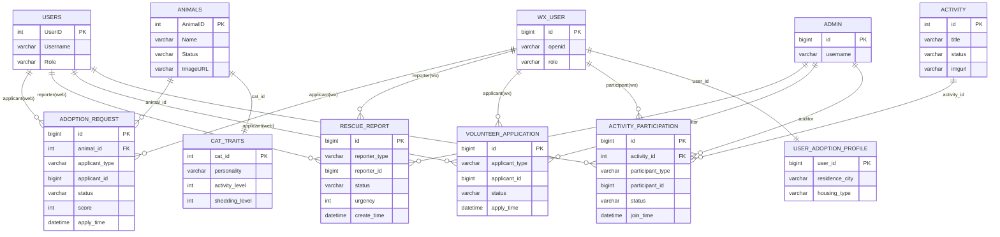

说明：为突出核心业务链路，ER 图仅保留“用户/猫咪/领养/救助/志愿者/活动/推荐画像”相关实体。由于业务记录同时支持网页端与小程序端用户，`adoption_request`、`rescue_report`、`volunteer_application`、`activity_participation` 通过 `*_type + *_id` 实现对 `users` 与 `wx_user` 的统一引用；该关系更多体现在业务逻辑与联表展示层面。

### 4.2.3 数据库表结构（详细）

本系统数据库以 MySQL 为核心，表结构主要来源于两部分：

- **SQL 初始化脚本**：用于创建推荐画像与权重表，以及志愿者与活动报名相关表（字段类型与约束以脚本为准）。
- **后端实体与 Mapper**：用于描述业务核心表（猫咪、活动、领养、救助、用户等）。由于历史表结构可能来自既有库，本文在此按工程实体与接口约定给出字段说明，字段类型以常见 MySQL 映射写法表达，最终以实际数据库为准。

#### 4.2.3.1 用户与权限相关表

**（1）网页端用户表 users**

| 字段 | 类型 | 约束 | 说明 |
|---|---|---|---|
| UserID | INT | PK | 用户ID |
| Username | VARCHAR | NOT NULL, UNIQUE | 登录账号 |
| Password | VARCHAR | NOT NULL | 登录密码（实际存储策略以系统实现为准） |
| Name | VARCHAR | NULL | 姓名 |
| Phone | VARCHAR | NULL | 手机号 |
| Gender | INT | NULL | 性别（编码） |
| Profile | VARCHAR/TEXT | NULL | 个人简介 |
| Avatar | VARCHAR | NULL | 头像URL |
| Role | VARCHAR | NOT NULL | 角色：user/volunteer/admin |

**（2）小程序用户表 wx_user**

| 字段 | 类型 | 约束 | 说明 |
|---|---|---|---|
| id | BIGINT | PK | 用户ID |
| openid | VARCHAR | NOT NULL, UNIQUE | 微信用户标识 |
| unionid | VARCHAR | NULL | UnionID（可空） |
| nickname | VARCHAR | NULL | 昵称 |
| avatar | VARCHAR | NULL | 头像 |
| role | VARCHAR | NOT NULL, 默认 user | 角色：user/volunteer |
| gender | INT | NULL | 性别（编码） |
| city/province/country | VARCHAR | NULL | 地理信息 |
| create_time | DATETIME | 自动 | 创建时间 |
| last_login_time | DATETIME | 自动 | 最近登录时间 |

**（3）管理员表 admin**

| 字段 | 类型 | 约束 | 说明 |
|---|---|---|---|
| id | BIGINT | PK | 管理员ID |
| username | VARCHAR | NOT NULL, UNIQUE | 管理员账号 |
| password | VARCHAR | NOT NULL | 管理员密码（支持加密存储） |

#### 4.2.3.2 猫咪与活动相关表

**（4）猫咪信息表 animals**

| 字段 | 类型 | 约束 | 说明 |
|---|---|---|---|
| AnimalID | INT | PK | 猫咪ID |
| Name | VARCHAR | NOT NULL | 名称 |
| Species | VARCHAR | NULL | 物种 |
| Breed | VARCHAR | NULL | 品种 |
| Age | FLOAT/DECIMAL | NULL | 年龄 |
| Gender | VARCHAR | NULL | 性别（雄性/雌性/未知） |
| HealthStatus | VARCHAR | NULL | 健康状况 |
| Description | TEXT | NULL | 描述 |
| ImageURL | VARCHAR | NULL | 图片路径 |
| Source | VARCHAR | NULL | 来源 |
| Status | VARCHAR | NOT NULL | 状态（如 ADOPTABLE/PENDING/ADOPTED） |

**（5）活动信息表 activity**

| 字段 | 类型 | 约束 | 说明 |
|---|---|---|---|
| id | INT | PK | 活动ID |
| title | VARCHAR | NOT NULL | 标题 |
| date | VARCHAR/DATETIME | NULL | 日期/时间（实际类型视库表定义） |
| location | VARCHAR | NULL | 地点 |
| detail | TEXT | NULL | 详情 |
| status | VARCHAR | NOT NULL | 状态（ongoing/upcoming/ended） |
| imgurl | VARCHAR | NULL | 封面图片路径 |

#### 4.2.3.3 领养相关表

**（6）领养申请表 adoption_request**

| 字段 | 类型 | 约束 | 说明 |
|---|---|---|---|
| id | BIGINT | PK | 申请ID |
| animal_id | INT | NOT NULL | 猫咪ID（关联 animals） |
| applicant_type | VARCHAR(10) | NOT NULL | 申请人来源：WEB/WX |
| applicant_id | BIGINT | NOT NULL | WEB→users.UserID，WX→wx_user.id |
| wx_user_id | BIGINT | NULL | 兼容字段（WX 场景下可用于联表与历史逻辑） |
| status | VARCHAR | NOT NULL | PENDING/APPROVED/REJECTED/CANCELED |
| apply_time | DATETIME | 自动 | 申请时间 |
| audit_time | DATETIME | NULL | 审核时间 |
| auditor_id | BIGINT | NULL | 审核人 |
| audit_reason | VARCHAR | NULL | 审核意见 |
| score | INT | NULL | 风险评分 |
| risk_level | VARCHAR | NULL | 风险等级 |
| risk_reasons | TEXT | NULL | 风险原因（可序列化存储） |

**（7）领养申请表单 adoption_form**

| 字段 | 类型 | 约束 | 说明 |
|---|---|---|---|
| request_id | BIGINT | PK, FK | 对应 adoption_request.id |
| family_income | DECIMAL | NULL | 家庭收入 |
| has_owned_pets | BOOLEAN | NULL | 是否养过宠物 |
| smoker | BOOLEAN | NULL | 是否吸烟 |
| asthma | BOOLEAN | NULL | 是否哮喘 |
| allergy | BOOLEAN | NULL | 是否过敏 |
| living_space | VARCHAR | NULL | 居住空间描述 |
| pet_friendly | BOOLEAN | NULL | 是否宠物友好 |
| work_hours | INT | NULL | 工作时长 |
| rent_or_own | VARCHAR | NULL | 租/自有 |
| family_members | INT | NULL | 家庭人数 |
| child_in_home | BOOLEAN | NULL | 是否有儿童 |
| accept_return_visit | BOOLEAN | NULL | 是否接受回访 |
| remarks | TEXT | NULL | 备注 |

**（8）领养记录表 adoption_record**

| 字段 | 类型 | 约束 | 说明 |
|---|---|---|---|
| id | BIGINT | PK | 记录ID |
| request_id | BIGINT | FK | 对应 adoption_request.id |
| animal_id | INT | FK | 对应 animals.AnimalID |
| wx_user_id | BIGINT | NULL | 领养人（WX 用户，兼容字段） |
| adopt_time | DATETIME | NULL | 领养时间 |
| contract_url | VARCHAR | NULL | 协议文件地址 |
| followup_plan | VARCHAR/TEXT | NULL | 回访计划 |

#### 4.2.3.4 救助、志愿者与报名相关表

**（9）救助上报表 rescue_report**

| 字段 | 类型 | 约束 | 说明 |
|---|---|---|---|
| id | BIGINT | PK | 上报ID |
| reporter_type | VARCHAR(10) | NOT NULL | 上报人来源：WEB/WX |
| reporter_id | BIGINT | NOT NULL | WEB→users.UserID，WX→wx_user.id |
| wx_user_id | BIGINT | NULL | 兼容字段（WX 场景） |
| lat/lng | DOUBLE | NULL | 经纬度 |
| address | VARCHAR | NULL | 地址 |
| description | TEXT | NULL | 描述 |
| image_urls | TEXT | NULL | 图片列表（可序列化存储） |
| urgency | INT | NOT NULL | 紧急程度 |
| status | VARCHAR | NOT NULL | OPEN/IN_PROGRESS/CLOSED |
| handler_id | BIGINT | NULL | 处理人（管理员） |
| handle_result | TEXT | NULL | 处理结果 |
| create_time | DATETIME | 自动 | 创建时间 |
| update_time | DATETIME | NULL | 更新时间 |

**（10）志愿者申请表 volunteer_application（来自脚本）**

| 字段 | 类型 | 约束 | 说明 |
|---|---|---|---|
| id | BIGINT | PK, 自增 | 申请ID |
| applicant_type | VARCHAR(10) | NOT NULL | 申请人来源：WEB/WX |
| applicant_id | BIGINT | NOT NULL | WEB→users.UserID，WX→wx_user.id |
| name | VARCHAR(50) | NOT NULL | 姓名 |
| phone | VARCHAR(20) | NULL | 电话 |
| age | INT | NULL | 年龄 |
| experience | TEXT | NULL | 爱心经历 |
| motivation | TEXT | NULL | 申请原因 |
| status | VARCHAR(20) | NOT NULL, 默认 PENDING | PENDING/APPROVED/REJECTED |
| apply_time | DATETIME | NOT NULL | 申请时间 |
| audit_time | DATETIME | NULL | 审核时间 |
| auditor_id | BIGINT | NULL | 审核人（管理员） |
| audit_reason | VARCHAR(255) | NULL | 审核意见 |

**（11）活动报名表 activity_participation（来自脚本）**

| 字段 | 类型 | 约束 | 说明 |
|---|---|---|---|
| id | BIGINT | PK, 自增 | 报名记录ID |
| activity_id | INT | NOT NULL | 活动ID |
| participant_type | VARCHAR(10) | NOT NULL | 报名人来源：WEB/WX |
| participant_id | BIGINT | NOT NULL | WEB→users.UserID，WX→wx_user.id |
| status | VARCHAR(20) | NOT NULL, 默认 PENDING | PENDING/APPROVED/REJECTED |
| join_time | DATETIME | NOT NULL | 报名时间 |
| audit_time | DATETIME | NULL | 审核时间 |
| auditor_id | BIGINT | NULL | 审核人（管理员） |
| audit_reason | VARCHAR(255) | NULL | 审核意见 |
| uk_activity_participant | UNIQUE | 唯一 | 同一活动同一用户只能报名一次 |

#### 4.2.3.5 推荐画像与权重相关表（来自脚本）

**（12）用户领养画像 user_adoption_profile**

| 字段 | 类型 | 约束 | 说明 |
|---|---|---|---|
| user_id | BIGINT | PK, FK→wx_user.id | 画像所属用户（小程序） |
| residence_city | VARCHAR(50) | NOT NULL | 居住城市 |
| housing_type | VARCHAR(20) | NOT NULL | 住房类型 |
| home_size_level | TINYINT | NOT NULL, 默认 2 | 房屋面积等级 |
| has_children | BOOLEAN | NOT NULL, 默认 FALSE | 是否有儿童 |
| has_other_pets | BOOLEAN | NOT NULL, 默认 FALSE | 是否有其他宠物 |
| allergy | BOOLEAN | NOT NULL, 默认 FALSE | 是否过敏 |
| max_shedding_level | TINYINT | NOT NULL, 默认 5 | 可接受掉毛等级 |
| daily_companionship_hours | TINYINT | NOT NULL, 默认 0 | 每日陪伴时长 |
| work_schedule | VARCHAR(20) | NOT NULL, 默认 DAY | 作息 |
| budget_level | TINYINT | NOT NULL, 默认 2 | 预算等级 |
| experience_level | TINYINT | NOT NULL, 默认 0 | 经验等级 |
| personality_preference | VARCHAR(20) | NOT NULL, 默认 ANY | 性格偏好 |
| accept_special_care | BOOLEAN | NOT NULL, 默认 FALSE | 是否接受特殊照护 |
| create_time | TIMESTAMP | 默认当前时间 | 创建时间 |
| update_time | TIMESTAMP | NULL | 更新时间 |

**（13）猫咪特征 cat_traits**

| 字段 | 类型 | 约束 | 说明 |
|---|---|---|---|
| cat_id | INT | PK, FK→animals.AnimalID | 猫咪ID |
| personality | VARCHAR(20) | NOT NULL, 默认 ANY | 性格类型 |
| activity_level | TINYINT | NOT NULL, 默认 3 | 活跃度 |
| affection_level | TINYINT | NOT NULL, 默认 3 | 亲人程度 |
| child_friendly | BOOLEAN | NOT NULL, 默认 TRUE | 是否亲子友好 |
| pet_friendly | BOOLEAN | NOT NULL, 默认 TRUE | 是否与其他宠物友好 |
| shedding_level | TINYINT | NOT NULL, 默认 3 | 掉毛等级 |
| nocturnal | BOOLEAN | NOT NULL, 默认 FALSE | 是否夜行 |
| space_need_level | TINYINT | NOT NULL, 默认 2 | 空间需求等级 |
| beginner_friendly | BOOLEAN | NOT NULL, 默认 TRUE | 是否新手友好 |
| special_care_needed | BOOLEAN | NOT NULL, 默认 FALSE | 是否需要特殊照护 |
| environment_preference | VARCHAR(20) | NOT NULL, 默认 ANY | 环境偏好 |
| create_time | TIMESTAMP | 默认当前时间 | 创建时间 |
| update_time | TIMESTAMP | NULL | 更新时间 |

**（14）匹配权重表 match_weights**

| 字段 | 类型 | 约束 | 说明 |
|---|---|---|---|
| weight_key | VARCHAR(50) | PK | 权重键（维度名） |
| weight_value | DECIMAL(6,3) | NOT NULL | 权重值 |

#### 4.2.3.6 行为日志表

**（15）用户行为表 user_behavior**

| 字段 | 类型 | 约束 | 说明 |
|---|---|---|---|
| id | BIGINT | PK | 行为ID |
| wx_user_id | BIGINT | NULL | 行为用户（WX 用户） |
| event | VARCHAR | NOT NULL | 行为类型（如 apply/rescue_report 等） |
| animal_id | INT | NULL | 关联猫咪 |
| request_id | BIGINT | NULL | 关联领养申请 |
| report_id | BIGINT | NULL | 关联救助上报 |
| extra | TEXT | NULL | 扩展信息 |
| create_time | DATETIME | 自动 | 创建时间 |

### 4.2.4 数据一致性设计要点

- 领养申请流程中采用“猫咪状态锁定”策略：当用户提交申请且猫咪处于可领养状态时，将猫咪状态置为 PENDING，避免多用户同时抢占导致的冲突；审核通过后置为 ADOPTED，并同步处理同猫其他未决申请。
- 统一主体标识：对“领养申请/救助上报/志愿者申请/活动报名”等数据，采用 `*_type + *_id`，实现跨端统一归属与管理端联表展示。

## 4.3 系统安全与权限模型（RBAC）

系统采用基于角色的访问控制（RBAC）：

- admin：可访问 `/api/admin/**` 管理接口。
- volunteer：可提交活动报名；同时在鉴权中保留普通用户能力。
- user：可访问一般业务接口（除管理员接口外）。

认证方式：

- Web 用户：账号密码登录获取 JWT（ptype=web）。
- 小程序用户：微信登录获取 JWT（ptype=wx）。
- 管理员：管理员登录获取 JWT（ptype=admin）。

JWT 在后端过滤器中解析并注入 Spring Security 上下文，前端通过请求拦截器在 Header 中携带 `Authorization: Bearer <token>`。

**本章小结**：本章完成总体架构与数据库设计，明确了跨端主体归属策略与 RBAC 权限模型，为系统实现提供设计依据。

---

# 第5章 系统实现（总—分结构，禁止贴源代码）

## 5.1 系统架构实现

### 5.1.1 架构描述文本

本系统实现采用“前后端分离 + 多终端接入”的总体架构。后端以 Spring Boot 为核心提供统一 REST API，负责鉴权、业务逻辑编排、数据持久化与静态资源服务。网页端基于 Vue3 实现用户端与管理端两类界面：用户端偏重信息浏览与表单提交；管理端偏重数据维护、审核流程与可视化统计。小程序端通过统一的网络请求封装访问后端接口，实现移动场景的救助上报、活动参与、志愿者申请等功能。

在鉴权实现上，系统以 JWT 作为跨端统一凭证：后端在安全过滤器中解析 token 并恢复当前主体（id、来源类型 ptype、角色 role），通过 Spring Security 的路径级规则实现管理员接口保护，保证敏感操作只能由管理员执行。对于涉及审核的业务（领养申请、志愿者申请、活动报名），系统采用明确的状态字段与状态流转约束，确保数据可追踪、流程可审计。

### 5.1.2 架构图（Mermaid）

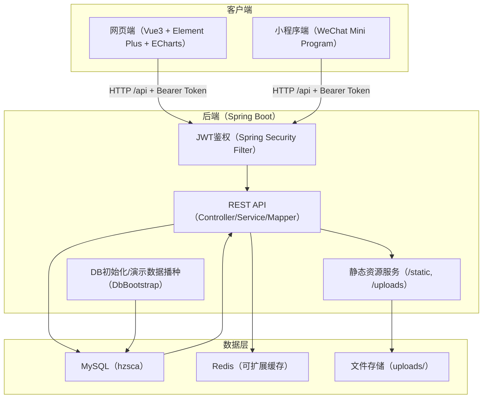

### 5.1.3 功能模块概览图（Mermaid）

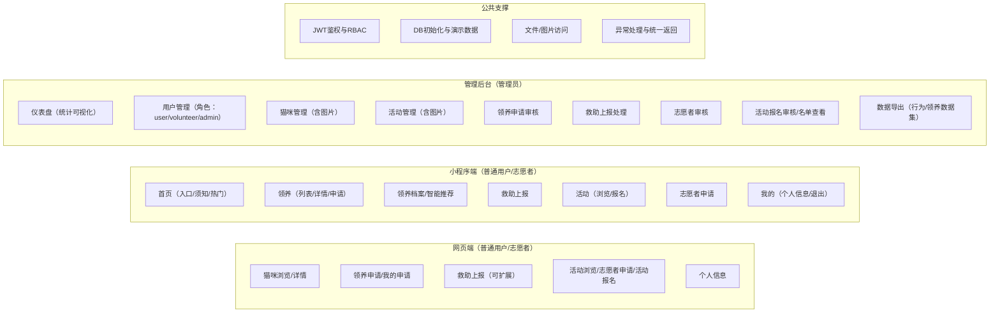

---

## 5.2 功能模块分述（按模块逐个阐述：功能+方案对比+截图+流程图）

> 说明：以下模块均不展示源码，仅描述关键接口、字段语义与流程；截图以占位符列出，需作者在系统运行后补充。

### 5.2.1 用户/管理员登录与鉴权模块（JWT + RBAC）

**功能实现说明**

本模块用于完成三类主体（网页端用户、小程序用户、管理员）的统一登录与权限控制。系统在登录成功后签发 JWT，客户端保存 token 与用户信息；后续请求统一在请求头携带 `Authorization: Bearer <token>`，后端在过滤器中解析 token 并恢复当前主体与角色，从而对受保护接口进行鉴权。

关键接口（示例）：

- Web 登录：`POST /api/auth/login`（users 表账号体系）
- 小程序登录：`POST /api/wx/login`（wx_user，基于 code 换取 openid）
- 管理员登录：`POST /api/admin/login`（管理员账号体系）

**流程图（Mermaid）**

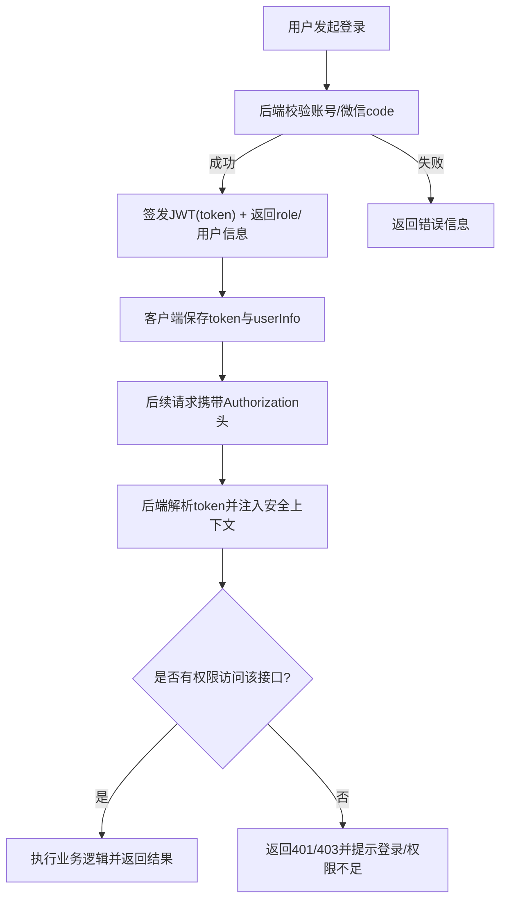

**实现与技术说明**

- 方案对比：Session+Cookie 属于服务端有状态方案，跨端与跨域部署需要额外的会话共享与安全策略；JWT 属于无状态方案，天然适配 Web 与小程序的统一接入。
- 选型理由：本系统终端多、功能以表单与审核流为主，采用 JWT 能以较低成本完成统一认证，并与 Spring Security 的角色控制形成清晰边界。

**实际截图（请在系统运行后补充）**

- 【截图：网页端登录页（用户登录）】
- 【截图：管理员登录成功进入后台仪表盘】
- 【截图：未登录访问受限页面提示与跳转】

### 5.2.2 猫咪信息管理模块（浏览 + 管理）

**功能实现说明**

本模块面向两类用户：普通用户侧提供“猫咪列表—猫咪详情”的浏览能力；管理员侧提供猫咪信息的维护能力（新增/编辑/删除）以及图片上传，以保障猫咪信息库的持续更新。

关键接口（示例）：

- 列表查询：`GET /api/cats`
- 详情查询：`GET /api/cats/{id}`
- 管理维护：`POST /api/cats`、`PUT /api/cats/{id}`、`DELETE /api/cats/{id}`
- 图片上传：`POST /api/cats/upload`

**流程图（Mermaid）**

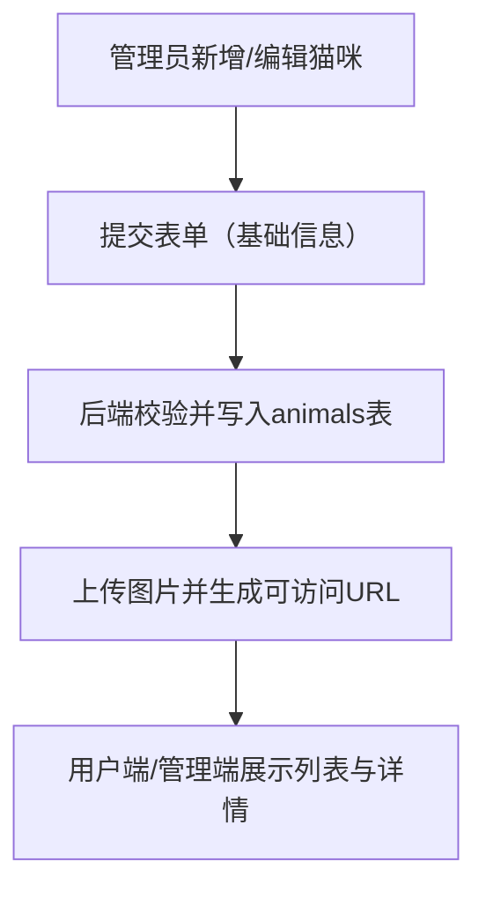

**实现与技术说明**

- 方案对比：对象存储适合生产环境，具备高可用与扩展能力，但引入配置与成本；本地上传目录映射实现简单，适合毕业设计。
- 选型理由：本系统以可运行与可演示为优先，采用“上传目录 + 静态映射”的方式，前端通过返回的图片路径完成展示。

**实际截图（请在系统运行后补充）**

- 【截图：网页端猫咪列表页】
- 【截图：网页端猫咪详情页】
- 【截图：管理员猫咪管理（新增/编辑/删除）】
- 【截图：猫咪图片上传与展示效果】
### 5.2.3 领养管理模块（申请 + 风险评分 + 审核）

**功能实现说明**

领养管理模块围绕“提交申请—风险评估—管理员审核—状态流转”形成闭环。用户在猫咪详情页发起领养申请并填写家庭与养宠相关信息，系统在提交阶段完成表单校验与风险评分，生成风险分值与等级，用于辅助管理员进行审核决策。为避免同一只猫被多人同时抢占造成冲突，系统在提交申请时对猫咪状态进行锁定：当猫咪处于可领养状态时置为待处理状态，审核完成或取消后再按规则释放或确认领养。

关键接口（示例）：

- 提交申请：`POST /api/adoption-requests`
- 我的申请：`GET /api/adoption-requests/my`
- 申请详情：`GET /api/adoption-requests/{id}`
- 取消申请：`POST /api/adoption-requests/{id}/cancel`
- 管理端列表：`GET /api/admin/adoption-requests`
- 管理端审核：`POST /api/admin/adoption-requests/{id}/approve|reject`

**流程图（Mermaid）**

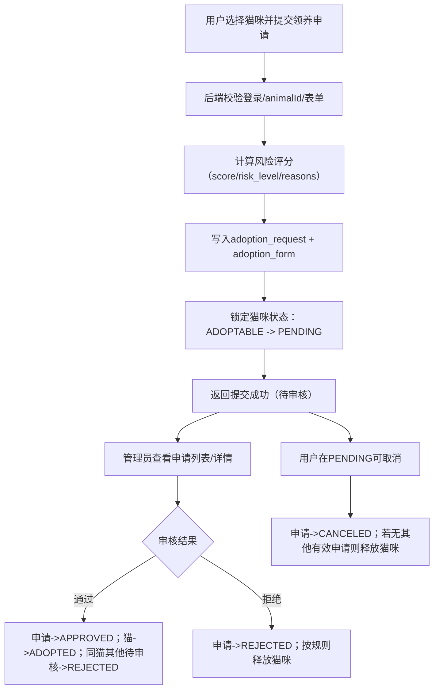

**实现与技术说明**

- 方案对比：若仅记录申请而不锁定猫咪，可能出现并发提交与审核冲突；采用状态锁定后，流程边界更清晰，用户与管理员都能在统一状态下推进。
- 风险评分：系统依据表单要素计算风险分值与等级，并给出风险原因列表。相比“完全人工审核”，该方式能减少重复判断成本；相比“复杂机器学习模型”，该方式实现简单、解释性强，适合本课题的数据规模与实现目标。

**实际截图（请在系统运行后补充）**

- 【截图：用户端领养申请表单页面】
- 【截图：我的申请列表与状态显示】
- 【截图：管理员端领养申请审核列表】
- 【截图：审核详情（风险评分、风险等级、理由）】

### 5.2.4 救助上报模块（提交 + 指派 + 关闭）

**功能实现说明**

救助上报模块面向移动场景下的紧急与高频需求：用户在发现需要帮助的猫咪后，可通过小程序快速填写位置、描述与紧急程度，并提交救助上报。后端将上报记录保存为待处理状态，管理员在后台统一查看并完成指派与关闭，形成“发现—上报—处置—反馈”的闭环。

关键接口（示例）：

- 提交上报：`POST /api/rescue-reports`
- 我的上报：`GET /api/rescue-reports/my`
- 管理端列表：`GET /api/admin/rescue-reports`
- 指派处理：`POST /api/admin/rescue-reports/{id}/assign`
- 关闭上报：`POST /api/admin/rescue-reports/{id}/close`

**流程图（Mermaid）**

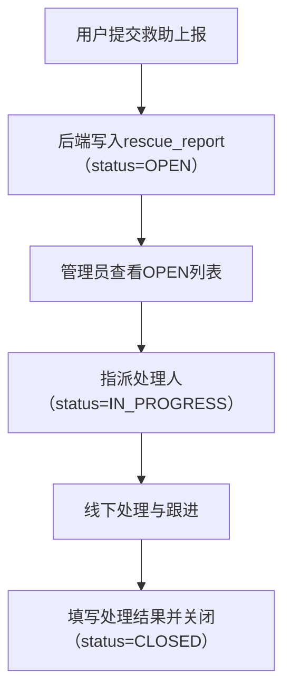

**实现与技术说明**

- 方案对比：纯文本上报虽然实现简单，但定位不明确会导致沟通成本上升、响应效率下降；“定位 + 描述 + 图片”能够显著提升信息完整性，更符合救助场景对时效性的要求。
- 选型理由：本系统以小程序作为主要移动端载体，能够较自然地完成定位授权、表单填写与提交，且与微信生态的使用习惯契合，便于推广与使用。

**实际截图（请在系统运行后补充）**

- 【截图：小程序救助上报表单（地址/描述/定位）】
- 【截图：管理员端救助上报列表】
- 【截图：指派处理与关闭结果填写】

### 5.2.5 活动模块（发布/展示/图片）

**功能实现说明**

活动模块用于承载协会的线上活动发布与传播：管理员在后台维护活动基本信息与封面图片；普通用户与志愿者可在网页端与小程序端浏览活动列表、查看活动详情，并在具备志愿者身份后进行报名。为兼顾展示效率与检索需求，活动信息以结构化字段进行管理，前端可按关键字、状态等维度进行筛选。

关键接口（示例）：

- 活动列表：`GET /api/activity/list`（开放访问）
- 新增活动：`POST /api/activity/add`
- 更新活动：`PUT /api/activity/update`
- 删除活动：`DELETE /api/activity/delete/{id}`
- 图片上传：`POST /api/activity/upload`

**流程图（Mermaid）**

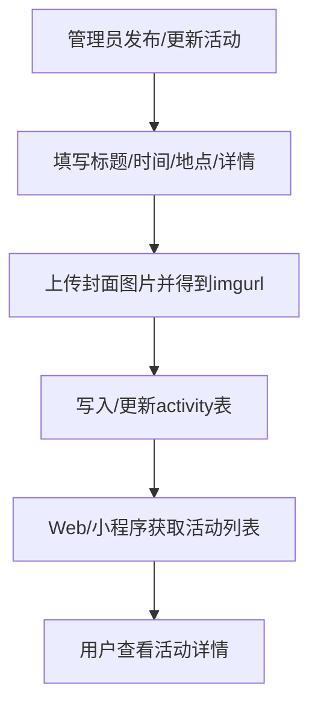

**实现与技术说明**

- 方案对比：富文本方案表达力更强，但会引入编辑器依赖、内容清洗与安全风险；结构化字段方案更轻量，字段清晰且易于筛选与展示。
- 选型理由：本系统活动内容以公告与组织信息为主，采用结构化字段即可满足需求，同时降低实现复杂度与维护成本。

**实际截图（请在系统运行后补充）**

- 【截图：网页端活动首页（含“成为志愿者”入口）】
- 【截图：小程序活动列表与筛选】
- 【截图：管理员活动管理（上传图片、编辑活动）】

### 5.2.6 志愿者模块（申请/审核/赋权）

**功能实现说明**

志愿者模块用于建立“身份门槛与组织能力”。普通用户在网页端或小程序端填写志愿者申请表，提交后进入待审核状态；管理员在后台统一审核，通过后为该用户授予志愿者角色。志愿者身份将作为后续活动报名的前置条件，使活动组织更可控。

关键接口（示例）：

- 提交志愿者申请：`POST /api/volunteer/apply`
- 管理端申请列表：`GET /api/admin/volunteers/applications`
- 管理端审核：`POST /api/admin/volunteers/applications/{id}/approve|reject`

**流程图（Mermaid）**

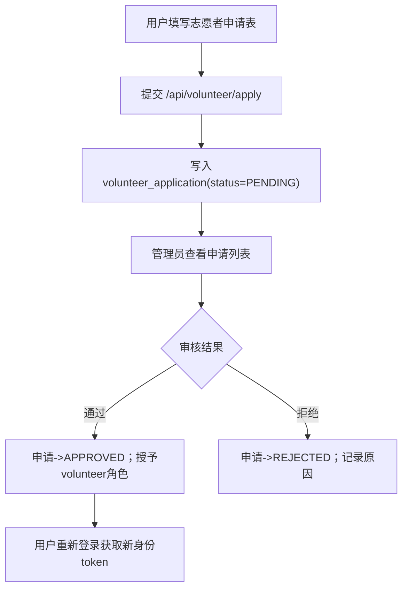

**实现与技术说明**

- 方案对比：若不设置志愿者身份门槛，用户可直接报名活动，组织成本与风险较高；采用“申请—审核—赋权”的方式更贴近真实公益组织流程。
- 选型理由：本系统场景规模较小但强调流程闭环与可追踪，审核制实现成本适中，且能体现 RBAC 权限模型在业务中的落地方式。

**实际截图（请在系统运行后补充）**

- 【截图：网页端“成为志愿者”申请表单】
- 【截图：小程序志愿者申请页面】
- 【截图：管理员端志愿者审核列表（通过/拒绝）】

### 5.2.7 活动报名模块（报名/审核/名单查看）

**功能实现说明**

活动报名模块在“志愿者身份”基础上进一步建立可控的参与机制：志愿者在活动详情页提交报名申请，系统将报名记录保存为待审核状态；管理员在后台按活动维度查看报名人员，并对报名进行通过或拒绝处理，最终形成可用于线下组织的参与名单。

关键接口（示例）：

- 提交报名：`POST /api/activity/join/{activityId}`
- 查看报名人员：`GET /api/admin/volunteers/activities/{activityId}/participants?status=`
- 审核报名：`POST /api/admin/volunteers/participations/{id}/approve|reject`

**流程图（Mermaid）**

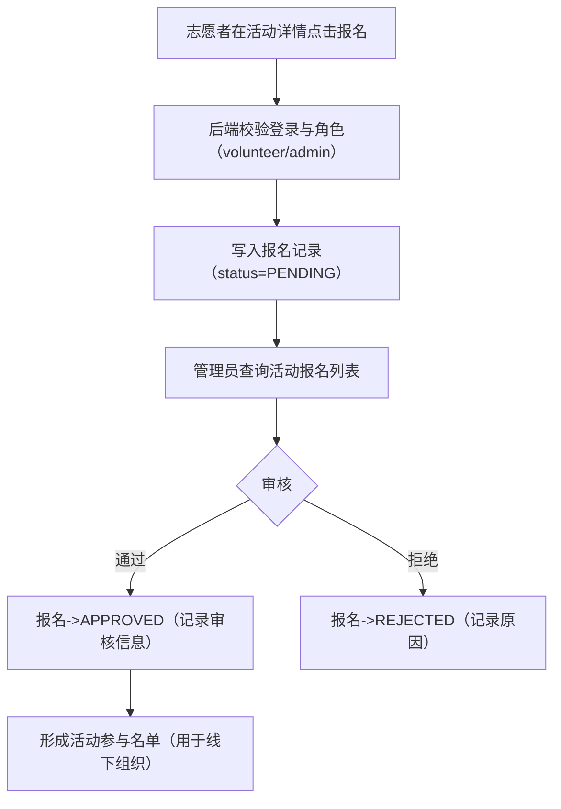

**实现与技术说明**

- 方案对比：报名即通过实现简单，但对人数与参与者质量不可控；报名后审核增加了管理步骤，但更适合公益活动组织与风险控制。
- 选型理由：本系统侧重流程闭环与可追踪，审核制能清晰展示状态流转，同时实现难度适中。

**实际截图（请在系统运行后补充）**

- 【截图：活动详情中“提交报名/预约参加”按钮】
- 【截图：管理员端活动报名审核（按活动ID查询、筛选状态、通过/拒绝）】
- 【截图：报名人员列表（来源、用户信息、报名时间、状态）】

### 5.2.8 管理后台数据可视化模块（ECharts）

**功能实现说明**

管理后台首页提供数据可视化能力，用于帮助管理员快速了解领养申请的整体情况与变化趋势。页面以“统计卡片 + 图表”的方式呈现关键指标：统计卡片用于展示总量与关键状态数量，图表用于展示状态分布与月度变化趋势，便于管理者进行直观判断与复盘。

数据来源（示例）：

- 领养数据集：`GET /api/admin/dataset/adoptions`（按分页拉取记录后在前端聚合）

**流程图（Mermaid）**

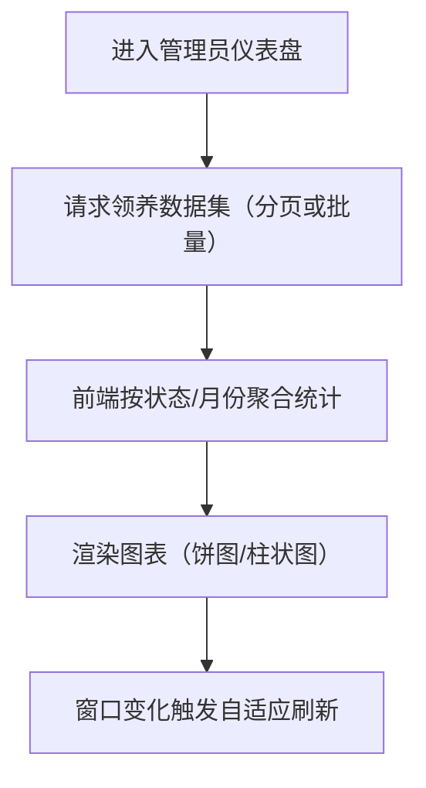

**实现与技术说明**

- 方案对比：后端聚合统计能保证权威性，但会增加接口数量与维护成本；前端聚合可快速调整统计维度，开发效率更高。
- 选型理由：本系统以毕业设计演示为主要目标，数据规模可控，采用“前端聚合 + ECharts”能在较少后端改动下完成清晰展示。

**实际截图（请在系统运行后补充）**

- 【截图：管理员仪表盘（统计卡片+饼图+柱状图）】

**本章小结**：本章采用“总—分结构”说明了系统架构与关键模块实现路径，重点阐述了跨端认证授权、状态流转、一致性控制与审核机制，并给出了对应的流程图与截图清单，满足工程性与可展示性要求。

---

## 5.3 PlantUML 图示（补充）

为便于在论文排版工具中统一渲染，下面补充本系统“功能模块图”和“关键流程图”的 PlantUML 版本。作者可根据学校模板要求对标题、编号与说明文字进行微调。

### 5.3.1 功能模块图（PlantUML）

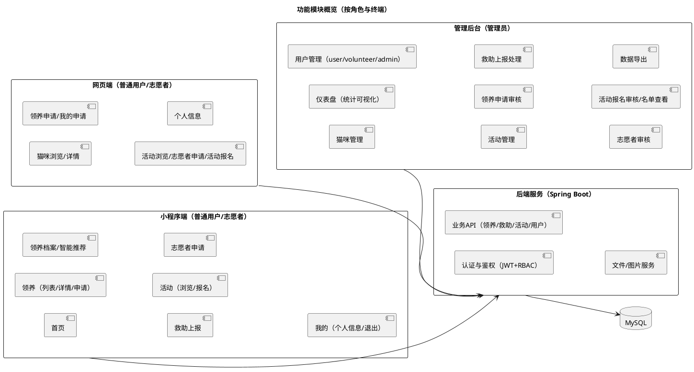

### 5.3.2 登录与鉴权流程（PlantUML）

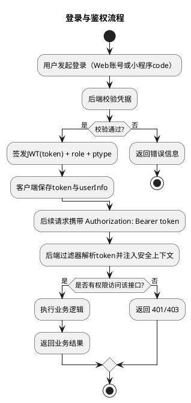

### 5.3.3 领养申请与审核流程（PlantUML）

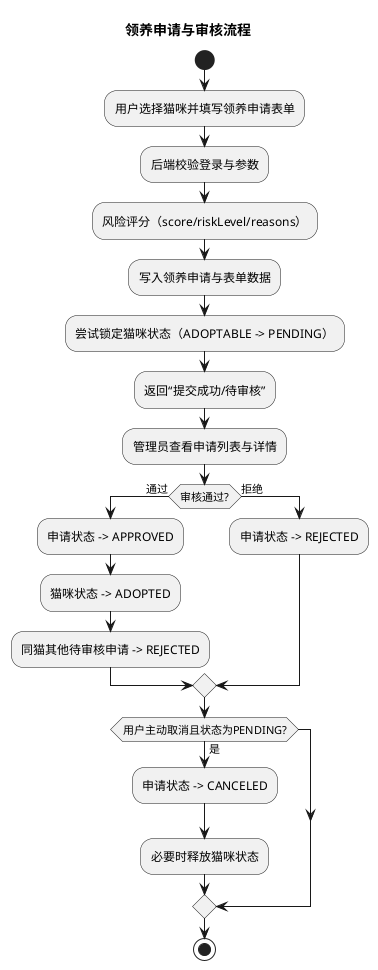

### 5.3.4 救助上报处理流程（PlantUML）

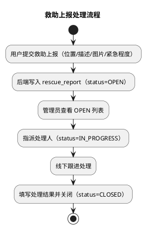

### 5.3.5 志愿者申请审核与赋权流程（PlantUML）

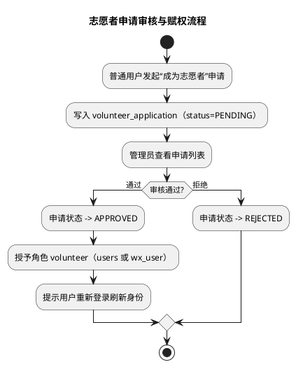

### 5.3.6 活动报名与审核流程（PlantUML）

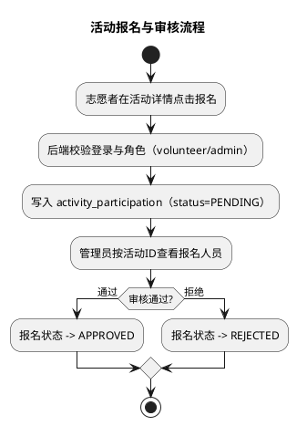

# 第6章 系统测试

在本章节中，主要在功能测试方面上对系统进行测试，验证系统的安全性、可用性以及稳定性。

## 6.1 系统测试的价值

系统测试在整个系统开发周期中堪称最后的关键环节，同时也是最为重要的阶段。能否将运行良好的系统顺利交付给客户，这全然取决于系统测试的执行。测试的主要目标是为了确保软件系统在满足用户需求的同时，也具备出色的稳定性和性能。最终，我们力求系统尽所有可能实现预期的所有目标。

## 6.2 系统测试的策略

在进行本次系统测试时，我们主要采用了功能测试和兼容性测试两种方法。

(1)功能测试：在对系统开展功能测试时，我们需针对各功能模块进行全面检测来确认其能否有效达成预先设定的用户需求及设计目标。功能测试手法主要包括黑盒测试和白盒测试，其中黑盒测试的核心关注点在于系统功能是否能按预期稳定运行，是否切实契合用户的实际需求；而白盒测试的重心则在于系统内部的逻辑是否准确，以及是否能够按照预设的过程顺利运行。

(2)兼容性测试：兼容性测试的目标是证实系统能否在多样化的设备、操作系统及浏览器环境中实现稳定兼容，常用的测试策略主要涵盖跨浏览器适配测试与跨设备兼容性验证等方式。

## 6.3 系统测试用例

测试用例是用于测试系统功能和验证预期结果的一组测试案例，该系统对应功能的测试用例以及其预期结果和实际结果如表 6-1 所示。

**表 6-1 系统核心功能测试用例表**

| 测试模块 | 用例名称 | 前置条件 | 操作步骤 | 预期结果 | 实际结果 |
| :--- | :--- | :--- | :--- | :--- | :--- |
| **登录与权限** | Web用户登录 | 用户已注册且账号正常 | 在登录页面输入正确的账号和密码，点击登录按钮 | 登录成功，系统跳转至首页，导航栏显示用户头像与昵称 | 登录成功，跳转正常 |
| **登录与权限** | 管理员后台登录 | 管理员账号存在 | 在后台登录页输入管理员账号密码 | 登录成功，进入后台管理仪表盘，左侧菜单完全展开 | 登录成功，菜单显示正常 |
| **领养管理** | 提交领养申请 | 用户已登录，目标猫咪处于“可领养”状态 | 在猫咪详情页点击“申请领养”，填写申请表单并提交 | 提示申请成功，猫咪状态变更为“申请中”，防止其他用户重复申请 | 申请成功，状态锁定生效 |
| **领养管理** | 领养申请审核 | 存在待审核的领养申请 | 管理员在后台查看申请详情，点击“通过” | 申请状态变为“已通过”，猫咪状态变为“已领养”，系统自动拒绝该猫咪的其他待处理申请 | 审核通过，并发控制正常 |
| **救助管理** | 提交救助上报 | 用户已登录（Web或小程序） | 填写救助地点、情况描述，上传现场图片后提交 | 系统提示上报成功，后台生成一条状态为“待处理”的救助记录 | 上报成功，后台数据同步 |
| **志愿者管理** | 志愿者身份申请 | 用户为普通用户身份 | 在活动页面点击“成为志愿者”，填写个人基本信息与爱心经历后提交 | 提示提交成功，等待管理员审核 | 提交成功，状态更新为待审核 |
| **志愿者管理** | 志愿者申请审核 | 存在待审核的志愿者申请 | 管理员在后台查看申请详情，点击“审核通过” | 用户角色更新为“志愿者”，拥有参与志愿活动的权限 | 审核通过，角色权限变更成功 |
| **活动管理** | 志愿者报名活动 | 用户已获得志愿者身份 | 在活动详情页点击“立即报名” | 提示报名成功，后台活动名单新增该用户的待审核记录 | 报名成功，记录生成正确 |
| **推荐系统** | 智能领养推荐 | 用户已在小程序端填写领养档案 | 在小程序“智能推荐”页面点击获取推荐 | 系统根据用户画像与猫咪特征，计算匹配度并返回推荐列表及推荐理由 | 成功返回推荐结果与匹配得分 |

**本章小结**：本章明确了系统测试的价值与策略，通过功能测试与兼容性测试方法，对系统的登录权限、领养流程、救助上报、志愿者申请及智能推荐等核心功能进行了全面的测试用例设计与执行验证，测试结果表明系统各项功能运行稳定，符合预期的设计目标。

---

# 第7章 总结与展望

## 7.1 总结

在本次研究中，完成了一套面向流浪猫救助与领养场景的多端协同系统。系统以微信小程序作为移动端入口，利用其便捷性与普及性，为用户提供救助上报、猫咪浏览与领养申请、志愿者申请与活动报名等功能；同时配套网页端与管理后台，支持猫咪信息维护、审核流程处理以及数据可视化统计。后端采用 Spring Boot 构建统一 REST API，并通过 JWT + RBAC 实现多端统一鉴权与权限隔离，保证管理员敏感操作与普通用户业务访问边界清晰。

研究结果表明，该系统在核心业务链路的正确性、功能可用性与运行稳定性等方面基本达到预期目标。尤其在“审核驱动”的业务中（领养申请、志愿者申请、活动报名），系统通过明确的状态流转与一致性约束，保证流程可追踪、结果可审计；在“智能推荐”方面，系统基于用户领养档案与猫咪特征档案计算匹配度并给出推荐理由，使推荐结果更具可解释性，能够在演示与实际试用中提升用户筛选效率。

在本次实现与测试过程中，也发现当前推荐模块仍存在数据稀疏与冷启动场景下的局限性：部分用户行为较少、画像维度有限时，推荐结果的区分度会受到影响。后续研究可进一步探索将深度学习等方法引入推荐系统领域，通过更强的特征学习能力挖掘“用户—猫咪”之间更复杂的潜在关联，从而提升匹配的稳定性与精准度。例如，可尝试使用自编码器[17]对用户画像与猫咪特征进行降维与重构，学习更具表达力的向量表示，再与现有匹配评分框架融合；也可引入图神经网络，将用户行为与猫咪交互构建为图结构，在图上进行信息传播与节点表示学习，捕捉更丰富的关系信息，增强推荐效果。

## 7.2 展望

（1）分布式计算与实时处理

分布式计算[18]能够将计算任务拆分为多个子任务，分发到不同节点并行执行，从而显著提升吞吐与扩展能力。在实际应用中，实时处理与实时推荐技术[19]已在内容分发、电商等场景被广泛验证。对于本系统而言，随着救助上报、领养申请与活动报名等数据量增长，统计聚合、审核队列处理、推荐候选生成等环节都可能成为性能瓶颈。未来可考虑引入消息队列与流式计算，将“上报—处理—统计—展示”改造为事件驱动链路，实现更及时的数据更新；同时将推荐计算与特征更新按任务拆分，结合缓存与异步化策略，提高高并发场景下的响应稳定性。

（2）边缘计算优化

当系统用户规模显著增长时，中心化部署在高峰期可能出现响应变慢甚至服务中断的风险；同时，图片与附件等静态资源在跨地域访问时也可能带来较高的加载延迟，影响用户体验。边缘计算在优化智能应用时，其核心思路[20]主要包括减少数据回传与提升就近处理能力：将部分计算与缓存下沉到边缘节点，降低带宽占用并减少端到端时延。但边缘资源分散与异构也会增加调度与一致性控制的复杂度[21]，需要进一步研究。

针对本系统，可在后续迭代中引入 CDN 与边缘缓存对图片/静态资源进行加速，并对推荐相关的特征读取、热点猫咪列表与基础配置进行就近缓存；后端可评估使用 Spring Native 与 GraalVM 进行轻量化部署，提升冷启动速度与资源利用率，在多节点扩展时降低运维成本，从而在保证安全与一致性的前提下进一步提升系统的整体可用性与访问体验。

---

# 参考文献（占位示例，需作者后续补齐）

[1] 【作者】. 【题名】[J]. 【期刊】, 【年份】.  
[2] 【作者】. 【题名】[M]. 【出版社】, 【年份】.  
[3] Spring Boot Reference Documentation.  
[4] Vue.js Documentation.  
[5] WeChat Mini Program Documentation.

---

# 致谢（示例）

在本次毕业设计过程中，感谢指导教师在选题、架构设计与论文写作方面给予的耐心指导与建议；感谢同学与朋友在系统测试、需求讨论与体验反馈方面提供的帮助；也感谢开源社区提供的 Spring Boot、Vue、Element Plus、ECharts 等优秀工具与框架，为本课题的实现提供了坚实基础。

---

# 需要作者补充的材料清单（用于最终排版与验收）

1. 学校论文模板对应的封面页（学校/学院/专业/学号/导师/日期等信息）。
2. 系统运行截图（按第5章各模块截图清单逐项补齐）。
3. 测试章节“实际结果”栏填写与关键用例截图/记录。
4. 真实参考文献条目（与学校要求格式一致）。
5. 若需打印版：图表编号（图5-1、表6-2等）与页眉页脚、目录自动生成设置。
